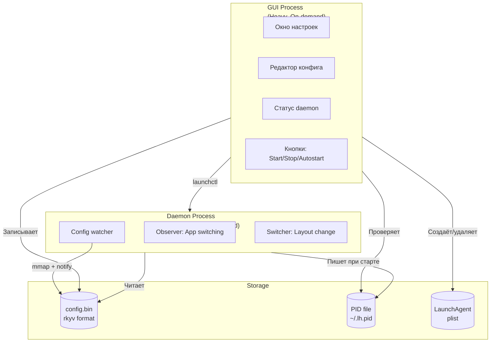

# Language Handler: Разделение GUI и Daemon

## Краткое описание

Проект Language Handler — утилита macOS для автоматического переключения раскладки клавиатуры в зависимости от активного приложения. Текущая архитектура монолитная: GUI и логика мониторинга объединены в одном процессе. Предлагается разделить на два независимых бинарных файла для улучшения производительности, уменьшения потребления памяти и независимого жизненного цикла.

---

## 1. Анализ текущей архитектуры

### Структура проекта

```
src/
├── main.rs          # Точка входа, вызывает run()
├── lib.rs           # Инициализация: GUI + observer + monitor
├── gui.rs           # Cocoa window: список приложений, dropdown языков
└── core/
    ├── config.rs    # JSON чтение/запись конфига
    ├── monitor.rs   # Отслеживание активного окна и раскладки
    ├── observer.rs  # macOS Notification observers
    ├── switcher.rs  # Логика переключения раскладки
    └── macos_api.rs # FFI биндинги к TIS*, CF* функциям
```

### Проблемы текущей архитектуры

| Проблема | Описание |
|----------|----------|
| **Связанность** | GUI и daemon работают в одном процессе — закрытие окна останавливает мониторинг |
| **Потребление памяти** | GUI загружает иконки всех приложений (~100+ приложений × иконка) |
| **JSON parsing** | Каждое переключение приложения требует обхода HashMap (не критично, но можно оптимизировать) |
| **Hardcoded моменты** | Статус "Active" всегда зелёный, нет реального отслеживания, нет кнопок управления |
| **Нет автозапуска** | Отсутствует интеграция с launchd |

---

## 2. Предлагаемая архитектура

### Два бинарных файла



### Ключевые решения

#### 2.1 Формат конфигурации: детальный анализ

##### Сравнение форматов

| Формат | Сериализация | Десериализация | Размер | Zero-copy | Новые зависимости |
|--------|--------------|----------------|--------|-----------|-------------------|
| **JSON** | ~1μs | ~2μs | Большой | ❌ | ❌ (уже есть serde_json) |
| bincode | ~35ns | ~125ns | Средний | ❌ | bincode |
| MessagePack | ~100ns | ~200ns | Маленький | ❌ | rmp-serde |
| **rkyv** | ~50ns | **0ns** | Средний | ✅ | rkyv + memmap2 |

##### Как работает rkyv (zero-copy)

rkyv использует **relative pointers** вместо абсолютных адресов. При сериализации:
1. Записываются сначала зависимости (строки, векторы)
2. Затем записываются смещения (offsets) вместо указателей
3. При чтении данные доступны напрямую через `mmap` без копирования в память

```rust
// Традиционная десериализация (bincode, JSON)
let config: Config = deserialize(bytes)?;  // Аллокация + копирование

// rkyv zero-copy
let archived = rkyv::check_archived_root::<Config>(&bytes)?;  // Просто cast указателя
println!("{}", archived.rules[0].app_name);  // Прямой доступ к данным в файле
```

##### Оценка для нашего случая

| Критерий | JSON | rkyv |
|----------|------|------|
| Размер конфига | ~50 правил × 50 байт = **~2.5KB** | ~2KB |
| Частота чтения | При каждом app switch (~10/мин) | То же |
| Время парсинга JSON 2.5KB | **~5-10μs** | 0ns |
| Overhead от зависимостей | 0 | +200KB в бинарнике |

> [!IMPORTANT]
> **Рекомендация: остаться на JSON**
> 
> Для конфига размером 2-5KB разница между 5μs и 0ns **несущественна** (10 переключений/мин = 50μs/мин). 
> Добавление rkyv + memmap2 увеличит бинарник daemon на ~200KB и усложнит код без ощутимой выгоды.
> 
> rkyv имеет смысл для данных >100KB или >1000 чтений/сек.

**Финальное решение**: Использовать **JSON** (serde_json уже есть). Кешировать конфиг в памяти, перечитывать по SIGHUP.

---

#### 2.2 Проверка статуса daemon: pgrep vs PID file

##### Варианты

| Метод | Описание | Плюсы | Минусы |
|-------|----------|-------|--------|
| **PID file** | Daemon пишет PID в файл при старте | Простой | Stale файл при crash, PID recycling |
| **pgrep** | `pgrep -x lh-daemon` | Точный, OS-level | Запуск процесса ps |
| **launchctl list** | `launchctl list \| grep lh` | Интеграция с launchd | Только если через launchd |
| **kill -0 PID** | Проверка сигналом | Быстро | Требует знать PID |

##### Проблемы PID file

1. **Stale PID**: Если daemon упал без graceful shutdown, файл остаётся с мёртвым PID
2. **PID recycling**: macOS может переиспользовать PID для другого процесса
3. **Race condition**: Между чтением файла и kill процесс может завершиться

##### Рекомендация: pgrep + CLI команда

```rust
// В GUI: проверка статуса
pub fn is_daemon_running() -> bool {
    Command::new("pgrep")
        .args(["-x", "lh-daemon"])
        .output()
        .map(|o| o.status.success())
        .unwrap_or(false)
}

// Терминальная команда для пользователя
// lh-daemon --status
pub fn print_status() {
    if is_daemon_running() {
        println!("🟢 Daemon is running");
    } else {
        println!("🔴 Daemon is not running");
    }
}
```

**CLI интерфейс daemon**:
```bash
lh-daemon          # Запустить в foreground
lh-daemon --daemon # Запустить в background (daemonize)
lh-daemon --status # Проверить статус
lh-daemon --stop   # Остановить (через pgrep + kill)
```

---

#### 2.3 Автозапуск: launchd + GUI интеграция

##### Размещение в GUI

Кнопка автозапуска располагается во **втором статус-баре** (y=335), который сейчас дублирует первый:

```
┌─────────────────────────────────────────────────────────────┐
│ 🟢 Daemon: Running                              [Stop]      │  ← Первый статус-бар (y=370)
├─────────────────────────────────────────────────────────────┤
│ ☐ Start at login                                            │  ← Второй статус-бар (y=335)
├─────────────────────────────────────────────────────────────┤
│ App List...                                                 │
└─────────────────────────────────────────────────────────────┘
```

##### Логика checkbox

```rust
// При создании окна: проверить текущее состояние
let autostart_enabled = is_autostart_enabled();
set_checkbox_state(checkbox, autostart_enabled);

// При клике на checkbox
extern "C" fn autostart_checkbox_action(_self: &Object, _cmd: Sel, sender: id) {
    let is_checked: bool = msg_send![sender, state] != 0;
    
    if is_checked {
        if let Err(e) = enable_autostart() {
            show_alert(format!("Failed to enable: {}", e));
            set_checkbox_state(sender, false);  // Откатить
        }
    } else {
        if let Err(e) = disable_autostart() {
            show_alert(format!("Failed to disable: {}", e));
            set_checkbox_state(sender, true);  // Откатить
        }
    }
}

// Проверка: добавлен ли уже в автозагрузку
pub fn is_autostart_enabled() -> bool {
    get_launchagent_path().exists()
}
```

##### LaunchAgent plist

```xml
<?xml version="1.0" encoding="UTF-8"?>
<!DOCTYPE plist PUBLIC "-//Apple//DTD PLIST 1.0//EN" 
  "http://www.apple.com/DTDs/PropertyList-1.0.dtd">
<plist version="1.0">
<dict>
    <key>Label</key>
    <string>com.languagehandler.daemon</string>
    <key>ProgramArguments</key>
    <array>
        <string>/path/to/lh-daemon</string>
    </array>
    <key>RunAtLoad</key>
    <true/>
    <key>KeepAlive</key>
    <true/>
</dict>
</plist>
```

---

## 3. План изменений

### Компонент 1: Реструктуризация Cargo workspace

Создать Cargo workspace с тремя crate:

#### [NEW] [Cargo.toml](file:///Users/rostislavnagimov/git/language-handler/Cargo.toml) (workspace root)

```toml
[workspace]
members = ["daemon", "gui", "common"]
resolver = "2"
```

#### [NEW] [common/](file:///Users/rostislavnagimov/git/language-handler/common/)

Общая библиотека:
- `config.rs` — rkyv-сериализуемая структура Config
- `paths.rs` — пути к конфигу, PID, plist
- `ipc.rs` — функции проверки статуса daemon

---

### Компонент 2: Daemon (lh-daemon)

#### [NEW] [daemon/Cargo.toml](file:///Users/rostislavnagimov/git/language-handler/daemon/Cargo.toml)

Минимальные зависимости:
```toml
[dependencies]
rkyv = "0.8"
cocoa = "0.24"
objc = "0.2"
signal-hook = "0.3"      # Для SIGHUP
memmap2 = "0.9"          # Для mmap конфига
```

#### [NEW] [daemon/src/main.rs](file:///Users/rostislavnagimov/git/language-handler/daemon/src/main.rs)

Логика:
1. Загрузить конфиг в кеш (`Config::reload_cache()`)
2. Установить signal handler для SIGHUP (reload config)
3. Запустить NSApplication run loop (headless, `NSApplicationActivationPolicyProhibited`)

**CLI аргументы**:
```bash
lh-daemon          # Запустить в foreground
lh-daemon --daemon # Fork в background
lh-daemon --status # Проверить запущен ли (через pgrep)
lh-daemon --stop   # Остановить (pgrep + kill)
```

#### Миграция модулей из текущего `src/core/`:

| Файл | Что происходит |
|------|----------------|
| `monitor.rs` | → `daemon/src/monitor.rs` (без изменений) |
| `observer.rs` | → `daemon/src/observer.rs` (без изменений) |
| `switcher.rs` | → `daemon/src/switcher.rs` (без изменений) |
| `macos_api.rs` | → `common/src/macos_api.rs` (используется обоими) |
| `config.rs` | → `common/src/config.rs` (JSON + кеширование) |

---

### Компонент 3: GUI (lh-gui)

#### [NEW] [gui/Cargo.toml](file:///Users/rostislavnagimov/git/language-handler/gui/Cargo.toml)

```toml
[dependencies]
common = { path = "../common" }
cocoa = "0.24"
objc = "0.2"
serde_json = "1.0"
```

#### [MODIFY] Текущий [gui.rs](file:///Users/rostislavnagimov/git/language-handler/src/gui.rs) → `gui/src/window.rs`

Изменения:
- Добавить статус-бар с **реальным** статусом daemon (проверка PID)
- Добавить кнопки: **Start Daemon**, **Stop Daemon**, **Enable Autostart**
- При изменении dropdown — сохранять конфиг через `common::config::save()`

#### [NEW] [gui/src/daemon_control.rs](file:///Users/rostislavnagimov/git/language-handler/gui/src/daemon_control.rs)

Функции управления daemon:

```rust
pub fn is_daemon_running() -> bool { /* pgrep -x lh-daemon */ }
pub fn start_daemon() -> Result<(), Error> { /* spawn lh-daemon */ }
pub fn stop_daemon() -> Result<(), Error> { /* pgrep + kill */ }
pub fn reload_daemon_config() -> Result<(), Error> { /* pgrep + kill -HUP */ }
pub fn enable_autostart() -> Result<(), Error> { /* write plist + launchctl load */ }
pub fn disable_autostart() -> Result<(), Error> { /* launchctl unload + remove plist */ }
pub fn is_autostart_enabled() -> bool { /* check plist exists */ }
```

---

### Компонент 4: Формат конфигурации (JSON с кешированием)

> [!NOTE]
> Решено остаться на JSON — rkyv не даёт существенного выигрыша для конфига 2-5KB при 10 чтениях/мин, но добавляет ~200KB к бинарнику и усложняет код.

#### [MOVE] current `config.rs` → [common/src/config.rs](file:///Users/rostislavnagimov/git/language-handler/common/src/config.rs)

```rust
use serde::{Deserialize, Serialize};
use std::collections::HashMap;
use std::sync::RwLock;

#[derive(Serialize, Deserialize, Default, Clone)]
pub struct Config {
    pub rules: HashMap<String, String>,  // app_name -> layout
}

// Daemon кеширует конфиг в памяти
static CONFIG_CACHE: RwLock<Option<Config>> = RwLock::new(None);

impl Config {
    pub fn load(path: &Path) -> io::Result<Self> {
        let content = fs::read_to_string(path)?;
        serde_json::from_str(&content).map_err(|e| io::Error::new(io::ErrorKind::InvalidData, e))
    }
    
    pub fn save(&self, path: &Path) -> io::Result<()> {
        let json = serde_json::to_string_pretty(self)?;
        fs::write(path, json)
    }
    
    /// Daemon вызывает при старте и по SIGHUP
    pub fn reload_cache(path: &Path) -> io::Result<()> {
        let config = Self::load(path)?;
        *CONFIG_CACHE.write().unwrap() = Some(config);
        Ok(())
    }
    
    /// Daemon использует для проверки правил (без disk I/O)
    pub fn get_cached() -> Option<Config> {
        CONFIG_CACHE.read().unwrap().clone()
    }
}
```

#### Пути файлов

| Файл | Путь |
|------|------|
| Конфиг | `~/Library/Application Support/language-handler/config.json` |
| LaunchAgent | `~/Library/LaunchAgents/com.languagehandler.daemon.plist` |
| Logs | `~/Library/Logs/language-handler.log` |

---

## 4. Завершение Hardcoded моментов

### 4.1 Статус daemon в GUI

**Текущее состояние**: Статус всегда "🟢 Background monitoring: Active"

**Решение**:
```rust
// В gui/src/window.rs при создании окна и по таймеру (каждые 2 сек)
fn update_status_bar(label: id) {
    let status = if daemon_control::is_daemon_running() {
        "🟢 Daemon: Running"
    } else {
        "🔴 Daemon: Stopped"
    };
    unsafe {
        let ns_str = NSString::alloc(nil).init_str(status);
        let _: () = msg_send![label, setStringValue: ns_str];
    }
}
```

### 4.2 Кнопки управления

Добавить в GUI три кнопки:

| Кнопка | Действие |
|--------|----------|
| **Start/Stop** | Toggle daemon через `start_daemon()` / `stop_daemon()` |
| **Enable Autostart** | Checkbox, вызывает `enable_autostart()` / `disable_autostart()` |
| **Save Config** | Сохранить текущие настройки dropdown'ов в конфиг |

### 4.3 Редактирование конфига

**Текущее состояние**: Dropdown'ы не сохраняют изменения

**Решение**: Добавить action handler на NSPopUpButton:
```rust
// При изменении popup -> обновить state -> auto-save или по кнопке Save
extern "C" fn popup_action(_self: &Object, _cmd: Sel, sender: id) {
    // Получить app_name из tag или user data
    // Получить выбранный layout
    // Обновить локальный state
    // Сохранить в конфиг
    // Отправить SIGHUP daemon'у
}
```

### 4.4 Автозапуск

**Реализация через launchd**:

```rust
pub fn enable_autostart() -> io::Result<()> {
    let plist_path = get_launchagent_path();
    let daemon_path = get_daemon_executable_path();
    
    let plist_content = format!(r#"<?xml version="1.0" encoding="UTF-8"?>
<!DOCTYPE plist PUBLIC "-//Apple//DTD PLIST 1.0//EN" "http://www.apple.com/DTDs/PropertyList-1.0.dtd">
<plist version="1.0">
<dict>
    <key>Label</key>
    <string>com.languagehandler.daemon</string>
    <key>ProgramArguments</key>
    <array>
        <string>{}</string>
    </array>
    <key>RunAtLoad</key>
    <true/>
    <key>KeepAlive</key>
    <true/>
</dict>
</plist>"#, daemon_path.display());
    
    fs::write(&plist_path, plist_content)?;
    
    // Load the agent
    Command::new("launchctl")
        .args(["load", "-w", plist_path.to_str().unwrap()])
        .output()?;
    
    Ok(())
}
```

---

## 5. Зависимости Cargo

### common/Cargo.toml
```toml
[dependencies]
serde = { version = "1.0", features = ["derive"] }
serde_json = "1.0"
```

### daemon/Cargo.toml
```toml
[dependencies]
common = { path = "../common" }
cocoa = "0.24"
objc = "0.2"
signal-hook = "0.3"
log = "0.4"
env_logger = "0.11"

[profile.release]
opt-level = 'z'
lto = true
codegen-units = 1
panic = 'abort'
strip = true
```

### gui/Cargo.toml
```toml
[dependencies]
common = { path = "../common" }
cocoa = "0.24"
objc = "0.2"
serde_json = "1.0"
```

---

## 6. Миграция данных

При первом запуске GUI:
1. Проверить наличие `config.json`
2. Если существует и `config.bin` отсутствует — мигрировать
3. Сохранить JSON как backup

---

## 7. Требуется уточнение пользователя

> [!WARNING]
> Следующие вопросы требуют решения перед реализацией:

1. **Установка daemon**: Куда устанавливать бинарник daemon?
   - `/usr/local/bin/lh-daemon` (требует sudo)
   - `~/Applications/Language Handler.app/Contents/MacOS/lh-daemon` (bundle)
   - `~/.local/bin/lh-daemon` (user-local)

2. **Обратная совместимость**: Нужно ли сохранять JSON параллельно с бинарным форматом для ручного редактирования?

3. **Logging**: Куда писать логи daemon?
   - `~/Library/Logs/language-handler.log`
   - `os_log` (macOS unified logging)

---

## 8. План верификации

### Автоматические тесты

В проекте отсутствуют существующие тесты. Предлагается добавить:

#### Unit tests для common/src/config.rs

```bash
cd common && cargo test
```

Тесты:
- `test_config_roundtrip_binary` — сериализация/десериализация rkyv
- `test_config_roundtrip_json` — сериализация/десериализация JSON
- `test_migration_json_to_binary` — миграция старого формата

#### Integration test для daemon lifecycle

```bash
cd daemon && cargo test --test integration
```

Тесты:
- `test_pid_file_created_on_start`
- `test_pid_file_removed_on_stop`
- `test_sighup_reloads_config`

### Ручная верификация

> [!IMPORTANT]
> Для полной проверки потребуется ручное тестирование на macOS.

1. **Build обоих бинарников**:
   ```bash
   cargo build --release -p daemon
   cargo build --release -p gui
   ```

2. **Запуск daemon вручную**:
   ```bash
   ./target/release/lh-daemon &
   # Проверить: cat ~/Library/Application\ Support/language-handler/daemon.pid
   ```

3. **Запуск GUI**:
   ```bash
   ./target/release/lh-gui
   # Проверить: статус-бар показывает "🟢 Daemon: Running"
   ```

4. **Изменение конфига через GUI**:
   - Выбрать приложение в списке
   - Изменить язык в dropdown
   - Нажать Save
   - Переключиться на это приложение
   - Проверить: раскладка изменилась

5. **Автозапуск**:
   - Включить checkbox "Start at login"
   - Выйти из сессии и зайти снова
   - Проверить: daemon запущен (через Activity Monitor или `ps aux | grep lh-daemon`)

6. **Stop daemon через GUI**:
   - Нажать "Stop Daemon"
   - Проверить: статус "🔴 Daemon: Stopped"
   - Проверить: PID файл удалён

---

## 9. Оценка трудозатрат

| Компонент | Оценка (часы) |
|-----------|---------------|
| Cargo workspace setup | 1 |
| common crate (config, paths, ipc) | 4 |
| Миграция core/* в daemon | 3 |
| daemon main + signal handling | 4 |
| GUI: daemon control buttons | 4 |
| GUI: реальный статус | 2 |
| GUI: сохранение конфига | 3 |
| GUI: autostart toggle | 2 |
| Unit tests | 3 |
| Integration testing | 2 |
| **Итого** | **~28 часов** |

---

## 10. Риски и митигации

| Риск | Митигация |
|------|-----------|
| rkyv версия несовместима | Версионирование через magic bytes в заголовке файла |
| Daemon не получает SIGHUP | Fallback на перезапуск (stop + start) |
| GUI падает при отсутствии daemon | Graceful degradation, все кнопки работают |
| launchctl требует полный путь | При установке автозапуска проверять/копировать бинарник |
